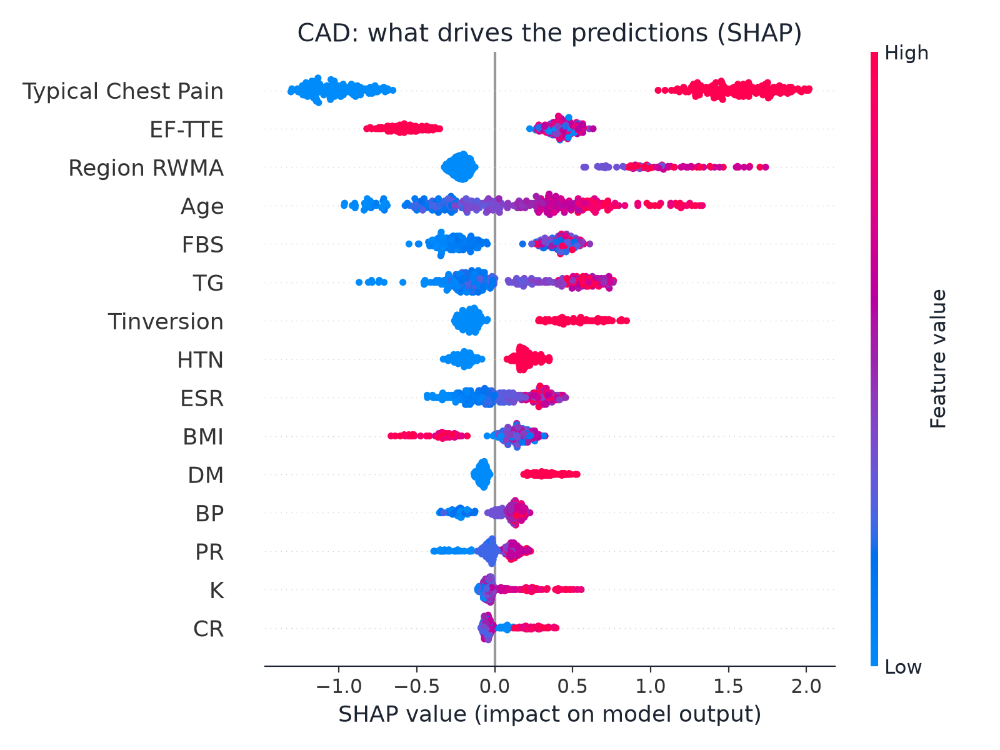
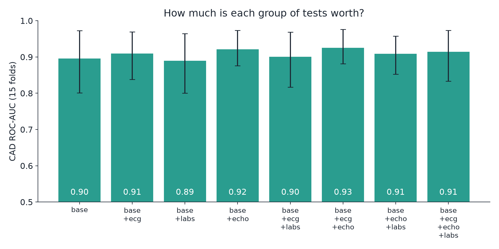

# Machine Learning (Nivedha)

## 1. Data
We use the Z-Alizadeh Sani (extended) coronary artery disease dataset (UCI, CC BY 4.0, DOI 10.24432/C5461K): 303 patients and 54 clinical inputs covering history, vitals, symptoms, ECG, laboratory tests and echocardiography. We predict four outcomes: overall coronary artery disease (CAD) and stenosis in each of the three main vessels, LAD, LCX and RCA. The classes are not balanced: stenosis is present in 216 patients for CAD (71%), 177 for LAD (58%), 119 for LCX (39%) and 114 for RCA (38%).

## 2. Preventing leakage
The four outcome columns are removed from the inputs, and an automated test (`test_no_target_column_in_inputs`) fails if any of them returns. Features are encoded numerically using one schema (`ml/feature_schema.json`) shared with the backend and frontend. Missing values are filled with the typical (median) value.

## 3. Validation and results
Each model is evaluated with stratified 5-fold cross-validation repeated 3 times (15 test folds). We report the mean and the 2.5th–97.5th percentile over the 15 folds, so every number comes with an honest interval.

**Final model (XGBoost), mean [95% interval over 15 folds]:**

| Target | ROC-AUC | Accuracy | Precision | Recall | F1 |
|---|---|---|---|---|---|
| CAD | 0.914 [0.833, 0.973] | 0.872 [0.779, 0.945] | 0.925 [0.839, 0.976] | 0.895 [0.837, 0.960] | 0.909 [0.847, 0.961] |
| LAD | 0.833 [0.770, 0.942] | 0.774 [0.709, 0.868] | 0.810 [0.752, 0.928] | 0.806 [0.689, 0.934] | 0.806 [0.736, 0.883] |
| LCX | 0.739 [0.619, 0.840] | 0.700 [0.632, 0.790] | 0.623 [0.532, 0.750] | 0.605 [0.446, 0.750] | 0.612 [0.489, 0.726] |
| RCA | 0.702 [0.603, 0.812] | 0.662 [0.583, 0.762] | 0.564 [0.438, 0.750] | 0.541 [0.373, 0.746] | 0.543 [0.412, 0.677] |

Pooled out-of-fold AUC (every patient predicted by a model that never saw them): CAD 0.91, LAD 0.83, LCX 0.74, RCA 0.70. For CAD at threshold 0.5, the confusion matrix is 70 true negatives, 17 false positives, 21 false negatives and 195 true positives.

## 4. Model comparison
We compared logistic regression, random forest and XGBoost with the same folds.

| Target | LogReg AUC | Random forest AUC | XGBoost AUC |
|---|---|---|---|
| CAD | 0.909 | 0.925 | 0.914 |
| LAD | 0.807 | 0.849 | 0.833 |
| LCX | 0.643 | 0.724 | 0.739 |
| RCA | 0.700 | 0.716 | 0.702 |

The differences in AUC are small compared with the fold-to-fold spread, so we do not claim that any one model is clearly best on AUC. We chose XGBoost because it gave the best balance of precision and recall on the harder vessels (LCX F1 0.61 against 0.44 for random forest, RCA F1 0.54 against 0.39; the random forest finds only about 30% of RCA cases at threshold 0.5), and because it works with exact tree-based SHAP explanations and with the bootstrap ensembles described below.

## 5. Explanations (SHAP)
For every prediction we compute SHAP values and show the top contributing inputs the user actually provided. For CAD the strongest drivers are Typical Chest Pain, EF-TTE (ejection fraction), Region RWMA and Age, which is clinically sensible. SHAP shows what the model associates with disease, not what causes it. In a small single-hospital dataset, a few features can behave unexpectedly.

## 6. Our extra: the Evidence Ladder and the Fog of Uncertainty
Patients rarely have every test on day one, so the model must say how sure it is with the information available.
- **Test groups.** Inputs are split into `base` (history, vitals, symptoms, always used) and three optional groups: `ecg`, `labs` and `echo`. We train a separate model for each of the 8 combinations and for each of the 4 targets.
- **Bootstrap ensembles.** Each model is an ensemble of 20 XGBoost models trained on bootstrap resamples. The prediction is the mean probability, and the interval is the 5th–95th percentile across the 20 models. A wider interval means the model is less sure; it is the "fog" in the 3D view. High, medium and low confidence labels are the tertiles of interval widths over all patients and test combinations.
- **Next-best-test.** For a patient with some groups missing, we find the 30 most similar patients in the training data, simulate adding each missing group using their values, and rank groups by how much the average interval width would shrink. A negative value means the extra test would add confusing evidence.
- **Value of each test (ablation).** CAD ROC-AUC by available tests: base only 0.896, base + ECG 0.910, base + echo 0.921, base + ECG + echo 0.925, base + labs 0.889, all groups 0.914. Echo and ECG add the most; the lab group does not help on this dataset. These gains are small compared with the fold-to-fold spread, so we describe them as a trend, not a proven difference. The average CAD interval narrows only modestly as tests are added (0.244 with base only, 0.214 to 0.223 with echo and ECG), which we report as it is.

## 7. Limitations
- Small dataset (303 patients) from one centre, with no external validation. Results may not transfer to other hospitals or populations.
- CAD is common in this dataset (71%), so predictive values would differ in a general population.
- LCX and RCA performance is modest (AUC about 0.70 to 0.74) and the intervals are wide; those predictions should be read with caution.
- Probabilities are not formally calibrated. Interval widths come from bootstrap spread and are not population-calibrated confidence intervals.
- SHAP explains the model, not the biology.
- CardioLens is an educational research prototype. It is not a medical device and must not be used for diagnosis or treatment decisions.